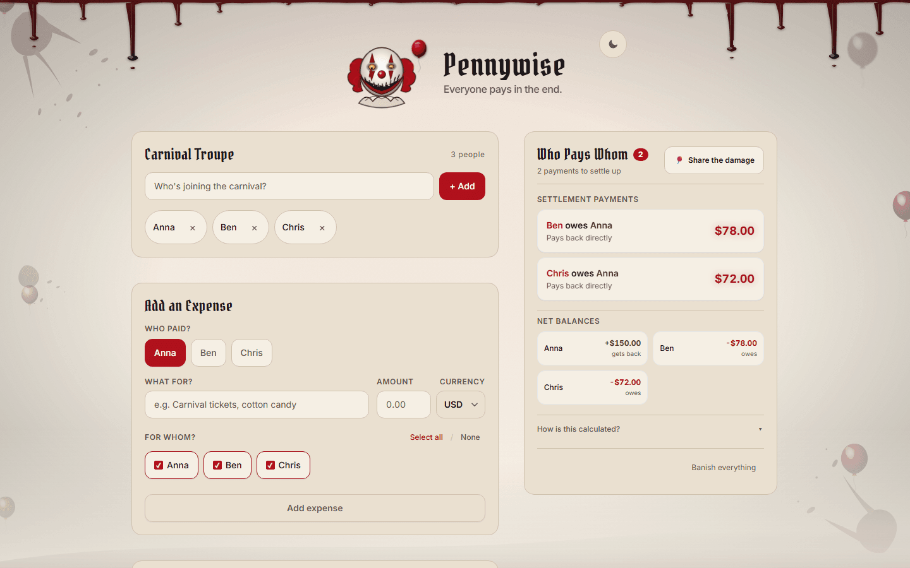
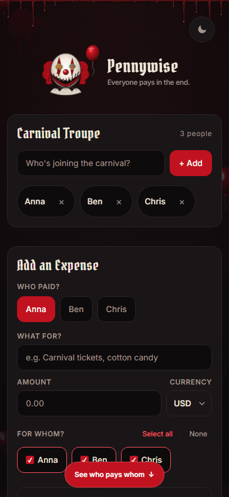
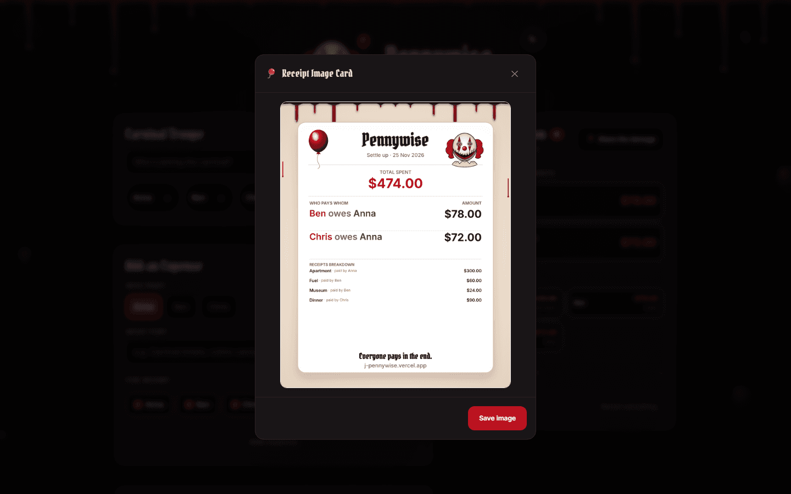

# Pennywise

[](https://github.com/JayCodess/Pennywise-Expense-Splitter/actions/workflows/ci.yml)
[](LICENSE)
[](https://react.dev/)
[](https://www.typescriptlang.org/)
[](https://tailwindcss.com/)
[](https://vitest.dev/)
[](https://nodejs.org/)

A client-only expense splitter with a playful carnival aesthetic that calculates the minimal transactions needed to settle group debts. Engineered with zero backend dependencies, full client-side privacy, and lossless integer arithmetic.


---

## Live Demo

**[https://j-pennywise.vercel.app](https://j-pennywise.vercel.app)**

---

## Features

### ⚖️ Optimal Settlement Algorithm

- **Greedy Minimum Cash Flow**: Simplifies quadratic group debt networks ($N \times (N-1)/2$) down to at most $N - 1$ settlement transactions.
- **Remainder Preservation**: Deterministic cent-by-cent remainder allocation guarantees that balances sum to exactly zero with zero rounding drift.

### 💰 Integer Minor-Units Arithmetic

- All financial state is stored and computed in integer minor units (cents, pence, paise).
- Eliminates standard IEEE 754 floating-point rounding inaccuracies.
- Supports 15 world currencies with localized formatting: USD (`$`), EUR (`€`), GBP (`£`), INR (`₹`), CHF, CAD, AUD, NZD, SEK, NOK, DKK, PLN, CZK, TRY, and ZAR.

### 🔒 Zero Backend & Absolute Privacy

- **Local-First**: All trip data resides strictly within `localStorage` inside the user's browser.
- No analytics trackers, no advertising cookies, no external API calls, and no databases.

### 📤 Multi-Channel Sharing & Export

- **Social & Native Sharing**: One-click integration with the Web Share API (`navigator.share`), WhatsApp, Telegram, SMS, and Email.
- **Receipt Image Card (PNG)**: Client-side HTML5 Canvas generator creating high-resolution 1080×1350 vertical PNG cards with custom typography, dynamic row distribution, and receipt breakdowns.
- **Decompressed URL Hash Links**: Compresses the entire trip state into a compact `#d=1.<payload>` hash via `CompressionStream('deflate-raw')` and base64url encoding.
- **RFC 4180 CSV Export**: Generates compliant spreadsheets with UTF-8 BOM encoding for seamless Microsoft Excel and Google Sheets imports.

### 🎪 Theme & Responsive Design

- **Dual Visual Modes**: Immersive Dark Carnival mode and Parchment Light mode.
- **Mobile-First Responsive Layout**: Dual-column desktop view with internal sticky scrolling, alongside single-column mobile view with a floating quick-jump action pill.
- **WCAG 2.1 AA Compliant**: High-contrast ratios, complete keyboard focus traps in modal dialogs, visible focus rings, and screen reader announcements.

---

## Screenshots

|                    Desktop Dark Mode                    |                    Desktop Light Mode                     |
| :-----------------------------------------------------: | :-------------------------------------------------------: |
|  |  |

|                   Mobile Dark Mode                    |               Share Options Menu               |                   Receipt Image Card                   |
| :---------------------------------------------------: | :--------------------------------------------: | :----------------------------------------------------: |
|  |  |  |

---

## Quick Start

### Prerequisites

- **Node.js**: `v20.0.0` or higher
- **npm**: `v10.0.0` or higher

### Installation

```bash
# Clone the repository
git clone https://github.com/JayCodess/Pennywise-Expense-Splitter.git
cd Pennywise-Expense-Splitter

# Install project dependencies
npm install

# Start the local development server
npm run dev
```

Visit [http://localhost:5173](http://localhost:5173) in your browser.

---

## Available Scripts

| Script                 | Command              | Purpose                                                                          |
| :--------------------- | :------------------- | :------------------------------------------------------------------------------- |
| `npm run dev`          | `vite`               | Starts local development server with Hot Module Replacement (HMR).               |
| `npm run build`        | `tsc && vite build`  | Type-checks with TypeScript and compiles optimized production assets to `dist/`. |
| `npm run preview`      | `vite preview`       | Serves the production build locally for verification.                            |
| `npm test`             | `vitest run`         | Runs all 92 unit and integration tests once.                                     |
| `npm run test:watch`   | `vitest`             | Runs the test suite in interactive watch mode.                                   |
| `npm run lint`         | `eslint .`           | Lints TypeScript and React source files with ESLint 9 flat config.               |
| `npm run lint:fix`     | `eslint . --fix`     | Automatically fixes safe ESLint warnings and code style errors.                  |
| `npm run format`       | `prettier --write .` | Formats all source files, configurations, and markdown docs with Prettier.       |
| `npm run format:check` | `prettier --check .` | Verifies project formatting compliance without modifying files.                  |
| `npm run typecheck`    | `tsc --noEmit`       | Validates TypeScript types across the entire project.                            |

---

## How the Settlement Algorithm Works

When friends travel together, peer-to-peer tracking creates redundant circular debts. For $N$ people, naive peer-to-peer settling can take up to $\frac{N(N - 1)}{2}$ transactions. Pennywise reduces this to at most $N - 1$ transactions using a greedy minimum cash flow algorithm.

### Step-by-Step Flow

1. **Calculate Net Balances**:
   For each person, compute:
   $$\text{Net Balance} = \text{Total Paid} - \text{Total Fair Share}$$
   - Creditors have a positive net balance ($\text{Net} > 0$).
   - Debtors have a negative net balance ($\text{Net} < 0$).
   - The sum of all net balances across all people equals exactly 0.

2. **Greedy Matching**:
   - Sort creditors descending by positive balance.
   - Sort debtors ascending by negative balance (largest debt first).
   - In each step, match the largest debtor with the largest creditor.
   - Settle the minimum of the absolute debt and the credit:
     $$\text{Settlement} = \min(|\text{Debtor Balance}|, \text{Creditor Balance})$$
   - Deduct the settled amount from both balances and repeat until all balances are zero.

### Worked Example (Anna, Ben, Chris)

Consider the built-in example troupe:

- **Apartment**: $300.00 paid by **Anna** for (Anna, Ben, Chris)
- **Fuel**: $60.00 paid by **Ben** for (Anna, Ben, Chris)
- **Museum**: $24.00 paid by **Ben** for (Ben, Chris)
- **Dinner**: $90.00 paid by **Chris** for (Anna, Ben, Chris)

**Total Spent**: $474.00

**Individual Shares**:

- **Apartment ($300.00)**: $100.00 each
- **Fuel ($60.00)**: $20.00 each
- **Museum ($24.00)**: $12.00 each (Ben & Chris only)
- **Dinner ($90.00)**: $30.00 each

**Balances**:

- **Anna**: Paid $300.00. Share: $100 + $20 + $0 + $30 = $150.00. **Net: +$150.00**
- **Ben**: Paid $84.00 ($60 + $24). Share: $100 + $20 + $12 + $30 = $162.00. **Net: -$78.00**
- **Chris**: Paid $90.00. Share: $100 + $20 + $12 + $30 = $162.00. **Net: -$72.00**

**Optimal Greedy Settlements**:

1. **Ben owes Anna $78.00** (Ben settled)
2. **Chris owes Anna $72.00** (Chris & Anna settled)

Total transactions: **2** (guaranteed $\le 3 - 1 = 2$).

---

## URL Sharing & Security Limits

Pennywise enables full trip sharing without a database by serializing state into a compressed URL hash (`#d=1.<base64url>`).

### Security & Denial-of-Service Defenses

To prevent URL-based memory exhaustion or payload attacks, strict boundary limits are enforced:

- **Payload Limit**: The base64url string is checked before decoding and rejected if it exceeds **8 KB**.
- **Decompression Limit**: The stream reader aborts immediately if decompressed JSON exceeds **64 KB**.
- **Data Validation Bounds**:
  - Maximum **50 people** per trip.
  - Maximum **500 expenses** per trip.
  - Person names capped at **60 characters**.
  - Expense descriptions capped at **120 characters**.
- **Safe Import Flow**: Opening a shared link starts the app in a **read-only view mode** with a persistent header banner. The existing local data is never overwritten without explicit user confirmation.

---

## Tech Stack

| Technology                                      | Version   | Purpose                                                           |
| :---------------------------------------------- | :-------- | :---------------------------------------------------------------- |
| [React](https://react.dev/)                     | `^18.3.1` | UI rendering with hooks (`useReducer`, `useMemo`, `useCallback`). |
| [TypeScript](https://www.typescriptlang.org/)   | `^5.7.2`  | Strict end-to-end type safety and static validation.              |
| [Vite](https://vitejs.dev/)                     | `^6.0.7`  | Fast development server and production bundler.                   |
| [Tailwind CSS](https://tailwindcss.com/)        | `~3.4.17` | Utility-first CSS styling with custom theme tokens.               |
| [Vitest](https://vitest.dev/)                   | `^2.1.8`  | Modern testing framework for unit and integration suites.         |
| [Testing Library](https://testing-library.com/) | `^16.1.0` | DOM interaction testing for React components.                     |
| [ESLint](https://eslint.org/)                   | `^9.16.0` | Flat configuration linting for TypeScript and React codebases.    |
| [Prettier](https://prettier.io/)                | `^3.4.2`  | Automated, consistent source code formatting.                     |

---

## Project Structure

```
pennywise/
├── .github/
│   ├── ISSUE_TEMPLATE/
│   │   ├── bug_report.md
│   │   └── feature_request.md
│   ├── PULL_REQUEST_TEMPLATE.md
│   ├── dependabot.yml
│   └── workflows/
│       └── ci.yml
├── docs/
│   ├── ARCHITECTURE.md
│   └── screenshots/
│       ├── desktop-dark.png
│       ├── desktop-light.png
│       ├── image-card.png
│       ├── mobile-dark.png
│       └── share-menu.png
├── public/
│   ├── apple-touch-icon.png
│   ├── favicon-32x32.png
│   ├── favicon.svg
│   └── og-image.png
├── src/
│   ├── components/            # UI components and integration test suites
│   │   ├── AddExpenseCard.tsx
│   │   ├── ExpenseListCard.tsx
│   │   ├── Header.tsx
│   │   ├── ImageCardPreviewModal.tsx
│   │   ├── PeopleCard.tsx
│   │   ├── ResultsCard.tsx
│   │   ├── ShareMenu.tsx
│   │   ├── ThemeToggle.tsx
│   │   └── Toast.tsx
│   ├── hooks/                 # Custom React state hooks
│   │   ├── expenseReducer.ts
│   │   ├── useExpenses.ts
│   │   └── useTheme.ts
│   ├── lib/                   # Pure business logic, math, and codecs
│   │   ├── constants.ts
│   │   ├── csvExport.ts
│   │   ├── imageCard.ts
│   │   ├── linkCodec.ts
│   │   ├── money.ts
│   │   ├── settle.ts
│   │   └── sharing.ts
│   ├── App.tsx
│   ├── index.css
│   └── main.tsx
├── eslint.config.js
├── index.html
├── package.json
├── tsconfig.json
└── vite.config.ts
```

---

## Testing

The project maintains comprehensive test coverage across 13 test suites with 92 passing tests covering math invariants, state transitions, UI edge cases, accessibility, and sharing codecs.

```bash
# Run the test suite once
npm test

# Run tests in watch mode
npm run test:watch
```

Test suites include:

- `money.test.ts`: Minor units parsing, currency formatting, and edge rounding behavior.
- `settle.test.ts`: Greedy settlement invariant checks, zero-sum verification, remainder allocation.
- `expenseReducer.test.ts`: Pure reducer state transitions, undo restoration, participant cascades.
- `linkCodec.test.ts`: Base64URL and deflate encoding, decompression limits, schema rejection.
- `InputUI.test.tsx`, `ResultsCard.test.tsx`, `ShareMenu.test.tsx`, `EdgeCases.test.tsx`: Integration and accessible DOM behaviors.

---

## Deployment

Pennywise is statically compiled and hosted on [Vercel](https://vercel.com).

- Automatic continuous deployment on push to `main`.
- Canonical metadata and Open Graph social tags are configured in `vite.config.ts`.
- Zero backend dependencies allow hosting on any standard static provider (Vercel, GitHub Pages, Netlify, Cloudflare Pages).

---

## Accessibility

- **Keyboard Navigation**: Full Tab, Shift+Tab, Arrow keys, Escape, and Enter navigation across cards, inputs, participant toggles, and modal dialogs.
- **Contrast**: Standard WCAG 2.1 AA text-to-background contrast ratios maintained in both dark and light themes.
- **Focus Indicators**: High-visibility focus rings on all interactive elements (`focus-visible:ring-2`).
- **Reduced Motion**: Respects `prefers-reduced-motion: reduce` by disabling floating animations and smooth transitions.
- **Non-Interfering Decor**: Decorative SVGs are strictly tagged with `pointer-events: none` and `aria-hidden="true"`, ensuring decor never obstructs interactive buttons or readable text.

---

## Contributing

Contributions are welcome! Please review [CONTRIBUTING.md](CONTRIBUTING.md) for branch naming standards, commit message conventions, and testing guidelines.

---

## License

This project is licensed under the MIT License - see the [LICENSE](LICENSE) file for details.
