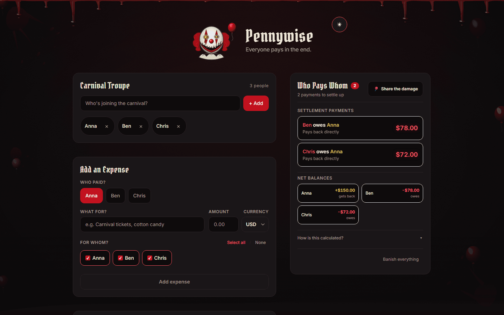
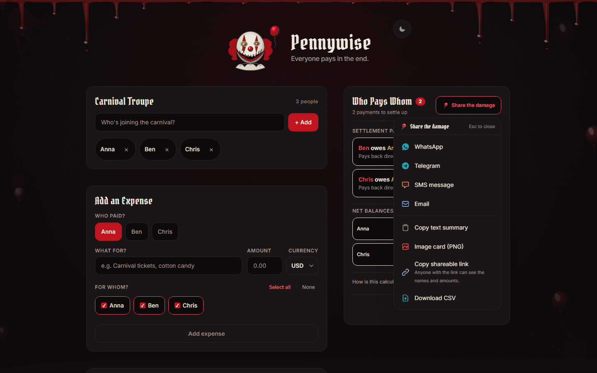

# Pennywise

[](https://github.com/JayCodess/Pennywise-Expense-Splitter/actions/workflows/ci.yml)
[](LICENSE)
[](https://react.dev/)
[](https://www.typescriptlang.org/)
[](https://tailwindcss.com/)
[](https://vitest.dev/)
[](https://nodejs.org/)

Add who paid for what, and Pennywise tells you who owes whom with the fewest possible payments. No sign-up, no server — your data never leaves your browser.

**[Live Demo → j-pennywise.vercel.app](https://j-pennywise.vercel.app)**

### Try it in 30 seconds

1. Open **[j-pennywise.vercel.app](https://j-pennywise.vercel.app)** and click **Load example troupe** to populate a sample trip.
2. Add a new expense or toggle participants to see balances update instantly.
3. Click **Share the damage** to copy a summary, download a receipt image card, or generate a shareable link.



---

## Features

- **Fewest Payments Possible**: Simplifies messy group tabs so everyone settles up in at most $N - 1$ transfers for $N$ people.
- **15 World Currencies**: Supports USD (`$`), EUR (`€`), GBP (`£`), INR (`₹`), CHF, CAD, AUD, NZD, SEK, NOK, DKK, PLN, CZK, TRY, and ZAR.
- **Private by Design**: Everything stays in your browser's `localStorage` — no accounts, cookies, trackers, or backend servers.
- **Share Anywhere**:
  - **One-Tap Messaging**: Share via native mobile share sheet, WhatsApp, Telegram, SMS, Email, or plain text.
  - **Receipt Image Card (PNG)**: Generates a crisp 1080×1350 vertical summary card ready for group chats.
  - **Shareable Link (`#d=...`)**: Compresses the trip directly into the URL hash so friends can view it in read-only mode without any server.
  - **CSV Export**: Downloads an Excel-friendly spreadsheet with separate expenses and settlements tables.
- **Dark & Light Themes**: Switch between Dark Carnival mode and Parchment Light mode anytime.
- **Accessible & Mobile-First**: Full keyboard navigation, screen reader announcements, 44px touch targets, and `prefers-reduced-motion` support.

### Under the hood

Pennywise stores every amount as integer minor units (cents, pence, paise) so floating-point rounding drift never happens, distributes indivisible remainders deterministically, and compresses shared links client-side with `CompressionStream('deflate-raw')`. See [docs/ARCHITECTURE.md](docs/ARCHITECTURE.md) for the full design.

---

## Screenshots

|                    Desktop Dark Mode                    |                    Desktop Light Mode                     |
| :-----------------------------------------------------: | :-------------------------------------------------------: |
|  |  |

|                   Mobile Dark Mode                    |               Share Options Menu               |                   Receipt Image Card                   |
| :---------------------------------------------------: | :--------------------------------------------: | :----------------------------------------------------: |
|  |  |  |

---

## Quick Start (Local Development)

### Prerequisites

- **Node.js** `v20` or higher
- **npm** `v10` or higher

```bash
# Clone the repository
git clone https://github.com/JayCodess/Pennywise-Expense-Splitter.git
cd Pennywise-Expense-Splitter

# Install dependencies
npm install

# Start the development server
npm run dev
```

Open [http://localhost:5173](http://localhost:5173) in your browser.

---

## Available Scripts

| Script                 | Command              | Purpose                                                                |
| :--------------------- | :------------------- | :--------------------------------------------------------------------- |
| `npm run dev`          | `vite`               | Starts local development server with Hot Module Replacement (HMR).     |
| `npm run build`        | `tsc && vite build`  | Type-checks with TypeScript and builds production assets into `dist/`. |
| `npm run preview`      | `vite preview`       | Serves the `dist/` production build locally.                           |
| `npm test`             | `vitest run`         | Runs all 92 unit and integration tests.                                |
| `npm run test:watch`   | `vitest`             | Runs tests in interactive watch mode.                                  |
| `npm run lint`         | `eslint .`           | Lints TypeScript and React files using ESLint 9.                       |
| `npm run lint:fix`     | `eslint . --fix`     | Auto-fixes safe ESLint warnings.                                       |
| `npm run format`       | `prettier --write .` | Formats all files with Prettier.                                       |
| `npm run format:check` | `prettier --check .` | Verifies Prettier formatting without modifying files.                  |
| `npm run typecheck`    | `tsc --noEmit`       | Runs TypeScript type-checking without emitting files.                  |

---

## How the Settlement Algorithm Works

When friends split multiple bills, settling every expense individually can take up to $\frac{N(N - 1)}{2}$ payments. Pennywise reduces that to at most $N - 1$ payments using a greedy minimum-cash-flow match:

1. **Net Balances**: For each person, calculate $\text{Total Paid} - \text{Total Fair Share}$. Positive means they are owed money; negative means they owe money. All balances sum to exactly zero.
2. **Greedy Matching**: Match the person who owes the most with the person who is owed the most, settle $\min(|\text{debt}|, \text{credit})$, and repeat until every balance is zero.

### Worked Example (Anna, Ben, Chris)

Using the built-in **Load example troupe** dataset:

- **Apartment**: $300.00 paid by **Anna** (split 3 ways: $100.00 each)
- **Fuel**: $60.00 paid by **Ben** (split 3 ways: $20.00 each)
- **Museum**: $24.00 paid by **Ben** (split between Ben & Chris: $12.00 each)
- **Dinner**: $90.00 paid by **Chris** (split 3 ways: $30.00 each)

**Total Spent**: $474.00

- **Anna**: Paid $300.00, Fair Share $150.00 → **+$150.00**
- **Ben**: Paid $84.00, Fair Share $162.00 → **-$78.00**
- **Chris**: Paid $90.00, Fair Share $162.00 → **-$72.00**

**Result (2 payments)**:

1. **Ben owes Anna $78.00**
2. **Chris owes Anna $72.00**

---

## Limits & Link Safety

To keep URLs short and protect your browser from malformed or oversized links:

- **Trip limits**: Up to **50 people** and **500 expenses** per trip; names up to **60 characters** and descriptions up to **120 characters**.
- **Shared link caps**: Base64url hash payloads are capped at **8 KB** before decoding, and decompressed JSON streams abort if they exceed **64 KB**.
- **Safe import**: Opening a `#d=...` link opens in a **read-only preview bar** (`Import` or `Exit`). Existing `localStorage` data is never overwritten without confirmation.

---

## Tech Stack

- **UI**: React 18, TypeScript, Tailwind CSS v3
- **Build & Test**: Vite, Vitest, Testing Library
- **Quality**: ESLint 9, Prettier

_(Exact dependency versions are tracked in [package.json](package.json).)_

---

## Project Structure

```
Pennywise-Expense-Splitter/
├── .github/                  # CI workflow, Dependabot config, issue/PR templates
├── docs/                     # Architecture guide & README screenshots
├── public/                   # Favicon, Apple touch icon, Open Graph image
├── src/
│   ├── components/           # UI cards, share menu, image card modal, decor, tests
│   ├── hooks/                # Store context (useExpenseStore), theme, toast
│   ├── lib/                  # Pure logic: money, settle, linkCodec, imageCard, csvExport
│   ├── App.tsx
│   ├── index.css
│   └── main.tsx
├── eslint.config.js
├── index.html
├── package.json
├── tailwind.config.js
└── vite.config.ts
```

---

## Contributing & License

Contributions are welcome — see [CONTRIBUTING.md](CONTRIBUTING.md) for guidelines and the PR checklist.

Licensed under the [MIT License](LICENSE).
