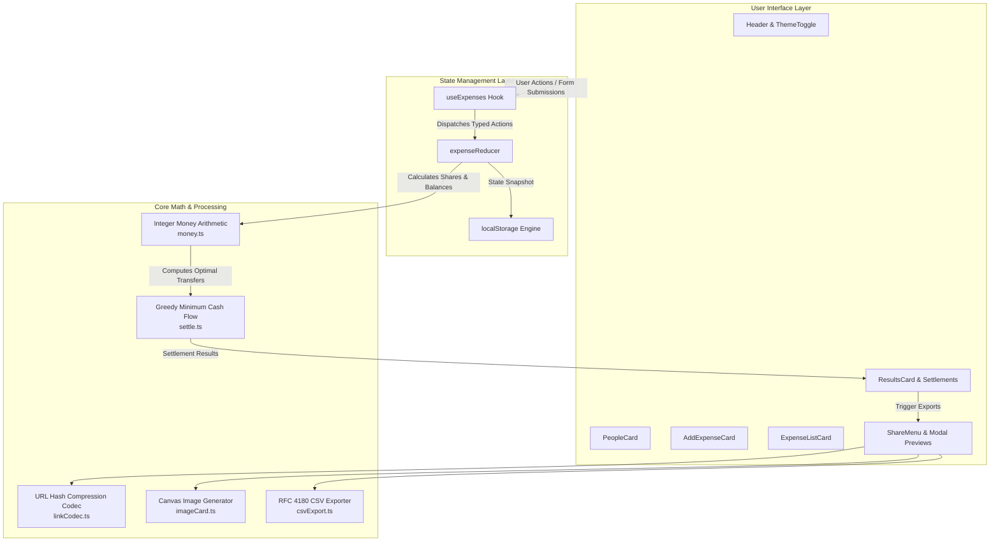

# System Architecture & Design Decisions

This document outlines the architectural principles, algorithmic models, data structures, and security considerations behind Pennywise.

---

## 1. High-Level Architecture Overview

Pennywise is designed as a **local-first, zero-backend single-page application (SPA)**. It operates entirely within the user's browser, eliminating external network dependencies, backend operating costs, latency, and privacy concerns.



---

## 2. Integer Minor-Units Arithmetic

### The Problem with Floating-Point Money

Standard JavaScript numbers follow IEEE 754 double-precision binary floating-point representation. Operations like `0.1 + 0.2` yield `0.30000000000000004`. In financial splitting apps, repeated floating-point divisions and subtractions accumulate compounding drift, resulting in non-zero net balances or missing cents.

### The Solution: Integer Minor Units

Pennywise represents all monetary values exclusively as integers in their minor currency units (e.g., cents, pence, paise):

- `$12.50` is stored internally as `1250`.
- Parsing parses user input string directly into an integer minor unit (`parseAmountToMinor`).
- Formatter converts integer minor units to localized currency strings on render (`formatMinorUnits`).

### Fair Remainder Distribution

When dividing an odd expense among participants (e.g., $10.00 among 3 people), simple division leaves integer remainders:
$$1000 \div 3 = 333 \text{ cents each with a remainder of } 1 \text{ cent}$$
Pennywise uses a deterministic remainder distribution:

- Each participant receives $\lfloor \text{amount} / N \rfloor$.
- The remainder $R = \text{amount} \pmod N$ is distributed +1 cent each to the first $R$ participants in stable participant-order.
- This guarantees:
  $$\sum \text{Shares} = \text{Total Expense}$$
  Balances across the group always sum to exactly zero.

---

## 3. Greedy Minimum Cash Flow Settlement Algorithm

### Graph Reduction

A group expense ledger forms a directed graph where edges represent debts between pairs of people. A naive peer-to-peer settlement would require up to $\frac{N(N - 1)}{2}$ transactions.

Pennywise simplifies this to a bipartite matching problem:

1. Compute the net balance for each participant:
   $$\text{Balance}_i = \text{Total Paid}_i - \text{Total Fair Share}_i$$
2. Separate participants into **Debtors** ($\text{Balance} < 0$) and **Creditors** ($\text{Balance} > 0$).
3. Sort Creditors descending by credit; sort Debtors ascending by debt.
4. Greedily match the largest debtor with the largest creditor. Settle $\min(|\text{Debt}|, \text{Credit})$.
5. Update balances and repeat until all balances are zero.

### Guarantees

- **Maximum Payments**: At most $N - 1$ transactions for $N$ people.
- **Zero-Sum Invariant**: Net balance sum is verified at every iteration.

---

## 4. URL Hash Codec & Hydration Security

Pennywise shares full trip states without requiring a database by compressing state directly into the URL hash fragment (`#d=1.<base64url>`).

```
[Plain State JSON]
       │
       ▼ CompressionStream('deflate-raw')
[Raw Deflated Bytes]
       │
       ▼ Base64URL Encoding
[URL Hash: #d=1.<payload>]
```

### Denial-of-Service & Injection Defenses

Because URL parameters originate from untrusted external sources, strict boundary validation is enforced:

1. **Payload Size Cap (Pre-Decode)**: The base64url string length is checked prior to decoding. If the string exceeds **8 KB**, it is immediately rejected without running CPU-intensive decompression.
2. **Decompressed Stream Abort Limit**: To prevent zip-bomb memory exhaustion, the decompression stream reads in small chunks with an accumulator. If total decompressed bytes exceed **64 KB**, the stream reader aborts immediately and raises a typed limit error.
3. **Strict Schema Hydration Validation**: Once JSON is parsed, `validateHydratedState` verifies that:
   - Total people $\le 50$.
   - Total expenses $\le 500$.
   - Person name length $\le 60$ characters.
   - Expense description length $\le 120$ characters.
   - All IDs, currency types, and participant references are non-null and internally coherent.
4. **Read-Only View Mode**: When launching from a `#d=...` hash, Pennywise enters an isolated preview mode. Local storage is **never** written to unless the user explicitly clicks "Import to my trips".

---

## 5. Non-Interfering Decorative Design (Decor Safety)

The visual design includes atmospheric elements (subtle blood drips, carnival banners, sewer grates, and balloons). To ensure aesthetic styling never impairs usability or accessibility:

- **Pointer Events Disabled**: All decorative SVGs and ambient illustrations enforce `pointer-events: none`.
- **Screen Reader Isolation**: All visual icons and illustrations carry `aria-hidden="true"`.
- **Z-Index Layering**: Interactive inputs, chips, modal dialogs, and buttons are placed in higher stacking contexts ($z \ge 10$) than background decor layers.
- **Contrast Ratios**: Core text and inputs strictly adhere to WCAG 2.1 AA 4.5:1 contrast standards in both dark and light themes.

---

## 6. Canvas & Font Lazy Loading

To keep initial bundle size minimal, receipt card generation is isolated into `src/lib/imageCard.ts` and loaded dynamically only when the user requests an image export:

- **Font Pre-loading**: Before drawing to HTML5 Canvas, the module calls `document.fonts.load()` for `Pirata One` and `Inter`, followed by `document.fonts.ready`. This eliminates font flickering or fallback default font rendering in generated images.
- **Standalone Artwork Injection**: Because external CSS variables and Tailwind classes do not apply inside Canvas image blobs, mascot and balloon SVGs are embedded with literal hex color attributes and loaded as standalone `Blob` URLs.
- **Dynamic Layout Engine**: Row heights, font sizes, and receipts sections dynamically adapt depending on settlement count (1–3 large rows, 4–5 medium rows, 6–8 compact rows) ensuring visual balance without empty gaps.
